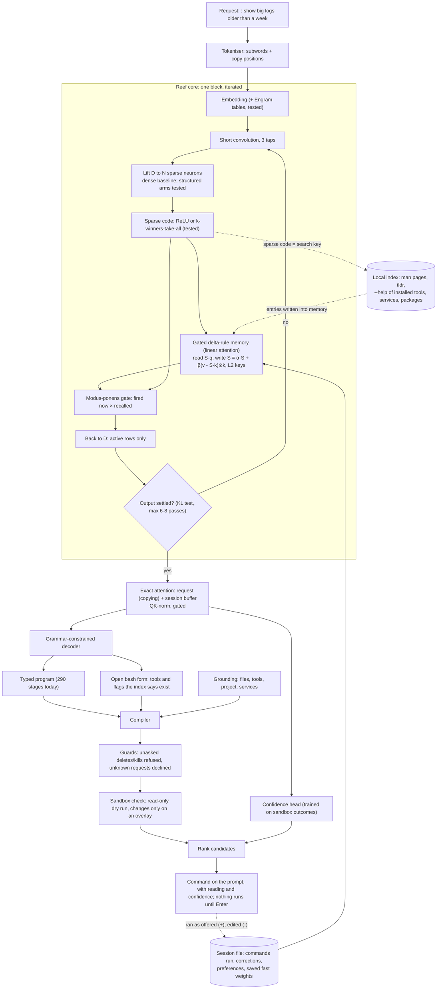

# Reef: the architecture for kural's next model

Status: design, not built yet. Every component is to be added one at a time and kept only if it improves the
measurements in "How we prove it". Revised on 2026-11-15 after a literature review
(`/home/srihari/Projects/reports/Reef architecture research leads.md`): several parts are now marked *test* rather
than settled, and two misreadings of sources are corrected. Today's kural (0.2) is a 3.6M-parameter encoder-decoder transformer with
pointer copying and grammar-constrained decoding; Reef replaces its network and keeps everything around it.

## 1. Goal and principle

A model of a few million parameters that turns what you mean into a correct command on your machine better than
general 8B-14B models do, running on the CPU in milliseconds, with no GPU at inference.

The principle: **only what must be learned goes into weights.** Parameters are the most expensive place to keep
anything: every weight costs memory and compute on every request. So:

| Job | Where it lives | Cost at inference |
|---|---|---|
| Understanding language, combining ideas | the core network (a few M parameters) | small |
| Phrase-level facts ("older than", "in place") | hashed lookup tables (Engram) | a lookup |
| Tools, flags, subcommands | a local index built from this machine | a lookup |
| Files, tools, project type, services | grounding code | none |
| Never producing an invalid program | the grammar | none |
| What was said earlier in the session | fast weights (delta-rule memory) | fixed-size |
| Being right | a sandbox check and a confidence head | a few ms |

## 2. Overview

## 3. Components

### 3.1 Input: subword tokens, copy positions, Engram tables
- A small byte-level BPE vocabulary (about 8-16k) learned on the pretraining text, replacing today's hashed letter
  triples. Every token keeps its character span, so the decoder can copy the user's exact text.
- **Engram tables** (from Needle 3 and DeepSeek's Engram) — *test*, not settled: token 1-, 2- and 3-grams hashed
  (several hash heads, prime table sizes, normalised token ids) into a table read at one early site through a learned
  gate. The published gains are mostly stored facts and need 10^5+ slots; at our table sizes the gain may be small.
  Measured on a paraphrase split against spending the same parameters on the embedding or the core.

### 3.2 The core block (iterated)
One set of weights, run repeatedly (recurrent depth, as in BDH, the Universal Transformer and Tiny Recursive Models).
Per pass:

1. **Short convolution** (3 taps, from Needle 3 and Gated DeltaNet): local word order before any memory access.
2. **Lift** from width D (about 128) to N sparse neurons — an *open choice*, tested in four arms at equal parameters
   and at equal compute: dense at N = 4-8k (the baseline, as in BDH), Monarch/BTT, product-key top-k selection, and
   Kronecker/Hadamard. (Correction: Needle 3 never lifts; its Hadamard MLP is a square, width-preserving mixer of
   about 25K parameters, and most of Needle's parameters are Engram tables. A Kronecker lift to 16k neurons has only
   about 3K free parameters, so its winner patterns would collapse into a grid; it is one arm, not the default.)
   Report neuron usage and code overlap alongside accuracy.
3. **Sparsity**: BDH's ReLU (about 5% active, as published) versus k-winners-take-all (exactly k active, 1-2%) —
   *test*. k-WTA gives fixed compute and less interference but risks dead neurons; it trains with gradients to the
   winners plus a boosting term.
4. **Delta-rule memory** (linear attention as Hebbian learning), in Gated DeltaNet's form. Read `y = S·q`, gated
   by a sigmoid. Write `S ← α_t·S + β_t·(v − S·k) ⊗ k` with **L2-normalised keys** (unnormalised delta networks
   diverge; a binary k-WTA key has ‖k‖² = k):
   - the delta term already stores only the surprise, so β_t = σ(W·x_t) is learned, optionally multiplied by an
     outside trust or outcome factor: near 1 for explicit corrections ("no, I meant png"), small for untrusted text
     from retrieved pages, so memories are loosened rather than erased by default;
   - α_t is a per-token decay gate (forgetting was the most important part of Titans' memory);
   - written once per token, never inside the pass loop (a memory that changes between passes is an untested
     feedback loop);
   - S is kept in a higher-precision accumulator (8-bit would round small writes to zero and silently undo
     "loosen"); pruning to exact zero is unvalidated and tested on its own;
   - size honestly: N × d_v is up to 4.2M numbers per head at N = 32k, larger than the model, which is a reason to
     prefer a smaller N or narrower values.
5. **Modus-ponens gate** (BDH): `active_now × recalled_from_memory`. A conclusion fires only when its premise is
   present and memory holds the rule. Iterating chains such steps.
6. **Back down to D**, computing only the k active rows of the output matrix.
7. **Early exit**: stop when the output head's distribution changes by less than a KL tolerance between passes, with
   hysteresis and a hard cap of 6-8 passes. ("The neuron pattern stopped changing" can cycle forever at the k-WTA
   boundary, and recurrent-depth models are documented falling into orbits.) Training follows the recurrent-depth
   and TRM recipe: a random number of passes, a loss at every pass plus KL toward the final pass, full backprop
   through the last pass, an EMA of the weights; monitor loss at 1 pass against the maximum to catch a model that
   ignores its passes. Whether more passes help at a few million parameters is itself a test.

### 3.3 Exact attention
Linear memory is lossy by design, which is right for meaning and wrong for copying (no fixed state can copy a long
string reliably, and the recall gap to softmax does not close with scale). So two small softmax attentions stay
exact, both with QK-norm, a sigmoid output gate and 3-tap q/k/v convolutions (adopted from Needle 3):
- over the current request's tokens (at most 44), which does the copying, so `report_v2-final.pdf` comes out
  character for character;
- over a bounded buffer of recent session tokens (about 2,000), for exact recall such as "the same file as
  before". This is the hybrid the evidence favours; the delta state keeps soft preferences and patterns.

### 3.4 Output
- **Typed program**: the existing program language, compiler and guards, unchanged. Exact and safe for common
  requests.
- **Open bash form**: for everything else. A bash grammar constrains every token; tool names must be installed and
  flags must appear in the local index entry for that tool. Invented flags are impossible by construction.

### 3.5 Knowledge outside the weights: the local index
Built at install time (and refreshed from a package-manager hook) from this machine: man pages, tldr pages,
`--help` output, services, packages. One entry per option or example. The core's sparse code is the search key;
the matching entries are written into the delta-rule memory with a low β (untrusted), as if they had been read.

### 3.6 Checking before answering
- Typed programs are pruned stage by stage while decoding (execution-guided decoding); complete open-bash
  candidates that are read-only run in a `bwrap` sandbox with a read-only view of the user's files. A failure drops
  a candidate down the list; empty output is only a ranking feature, since "are there any core dumps?" can
  correctly find nothing.
- Commands that change things run only on a throwaway copy-on-write overlay, and are checked against the request
  ("only the files asked for were deleted"). Network, sudo and services are never dry-run.
- A **confidence head**, trained on whether commands succeeded in the sandbox, gives a confidence that means
  something; the reported confidence is the minimum of the head and the decoding probability (Needle's rule). It is
  recalibrated after every fine-tune and evaluated by AUROC, calibration error and accuracy-versus-coverage,
  including on tool families held out of training. Today's confidence is the model's own probability and is not
  calibrated.

## 4. Learning

### 4.1 Training (offline, GPU, CUDA)
1. **Pretraining** on English: Wikipedia, openly licensed conversational text, Stack Exchange (Unix & Linux, Ask
   Ubuntu, Super User, Server Fault, Stack Overflow bash/linux tags), man pages, tldr. Next-token prediction plus a
   JEPA objective (4.3). OPAL can tune the optimiser during this long run.
2. **Fine-tuning** on request-to-program pairs: the Rust generator (`gen/`); **paraphrases written by a larger local
   model, kept only when the current parser maps them back to the same program** (the round-trip filter alone was
   worth about 18 points in AutoQA, and this is the evidence-backed fix for template-only data); alias annotations
   for tools and flags from the local index; Stack Exchange question titles paired with commands from accepted
   answers (parsed into programs); filtered NL2SH-ALFA training pairs and tldr pages; in future, users' corrections
   (opt-in).
3. **Reinforcement learning in the sandbox**: several candidates per request, executed; reward when the effect
   matches the reference command's effect, penalty for doing more than asked (deleting or killing extra).
4. **Quantisation**: integer W8A8 kernels on AVX-VNNI with Hadamard-rotated activations (8-bit is close to lossless
   after rotation). Low-bit quantisation-aware training at the end of training only if file size matters. Ternary
   from the start is ruled out: below 50M parameters it has about half the capacity of 16-bit.

### 4.2 Learning during use: two speeds
- **Fast weights** (the delta-rule state S) learn instantly from every request and outcome, with a third factor:
  the outcome (ran as offered, edited, or abandoned) scales β. They live in the session file and go away with it.
  Learning within a session is supported by TTT and Titans (within one sequence, at 125M-3B parameters), and needs
  training on session-shaped sequences. Keeping fast weights across sessions is experimental: capped by age and
  size, with a reset, and with trusted corrections and untrusted retrieved text in separate states.
- **Slow weights** (the trained parameters) never change during use. An offline **consolidation** run ("sleep")
  replays corrections and good outcomes into them, and the result is kept only if no test set gets worse. This
  avoids slowly forgetting other skills and stops a malicious file or page from teaching the model a rule.

### 4.3 Leads from other work

Verdicts from the literature review (sources and numbers in the report named at the top).

| Idea | Verdict | What we take, and why |
|---|---|---|
| **BDH** (Pathway) | test | The core block. Its evidence covers a ReLU lift (about 5% active), additive Hebbian memory and dense matrices, from 10M parameters up; Reef's k-WTA, delta rule and structured lift are untested departures, so "BDH as published" is its own ladder step. |
| **BDH-CQ** | skip | 150M parameters, ARC only, architecture undisclosed. |
| **Needle 3** (Cactus) | adopt parts | QK-norm (removing it made training diverge), sigmoid attention output gate, 3-tap q/k/v convolutions, a confidence head combined by minimum with the decoding probability. Not a source for a wide lift. |
| **Gated DeltaNet / DeltaNet** | adopt | The memory write; best recall among fixed-state layers; short convolution and L2 keys matter. |
| Mamba-2, GLA, RetNet | skip | Weaker recall than the delta rule. RWKV-7 is the fallback if Gated DeltaNet underperforms. |
| **Hybrids** (a few softmax layers) | adopt | The exact request and session attentions (3.3); hybrids close or reverse the recall gap. |
| **TTT, Titans** | test | Learning within a session; TTT-MLP and deep Titans memories skipped. |
| **JEPA, LLM-JEPA** | test | An auxiliary regulariser after paraphrase augmentation. Evidence only at 1B+ and in-distribution (NL-RX +14 points at 1B); no out-of-distribution test exists, and the contrastive variant scored below baseline. Not used as a reranker. |
| **Tiny Recursive Models, HRM** | adopt the recipe | Deep supervision, full backprop through the last pass, EMA. Their ARC gains depend on puzzle IDs, voting and the outer refinement loop; there is no evidence on language. HRM's two-level hierarchy is skipped. |
| **Recurrent depth** (Geiping et al.) | adopt the recipe, test the gain | Random pass counts, KL exit; results exist only at about 3.5B. |
| ACT, PonderNet | skip | Learned halting is unstable; a KL tolerance with a cap is used instead. |
| **NNUE** | adopt the sparse-input kernel | Only active neurons' weight columns are read. The incremental accumulator applies only to the embedding/Engram sum and the causal state; built only if live preview measurably needs it. |
| **Product-key memory, Engram** | test Engram; product keys as a lift arm | Large-memory gains need 10^5+ slots. |
| Modern Hopfield networks | sizing tool | Capacity of the delta state is about d_k associations; softmax retrieval is exponential. |
| Vector symbolic architectures | skip | No semantic-parsing results; the delta outer product is already learned binding. |
| **BitNet b1.58** | skip | Half the capacity below 50M; its speed-ups come from memory bandwidth a cache-resident model does not need. |
| Differentiable logic gate networks | skip | Weak on language; decline and route heads are probe heads instead. |
| **Execution-guided decoding** | adopt | Stage-by-stage pruning of typed programs; sandbox runs of complete open-bash candidates (3.6). |
| **Execution-based RL** (GRPO) | test | After supervised training stops improving; asymmetric penalties, randomised file trees, the checker outside the sandbox. |
| **Jev** (TypeSafe AI) | skip | Hosted, closed, early access; calibration claimed by the vendor, not published. |
| **Paraphrase augmentation with a round-trip filter** (AutoQA) | adopt | The strongest evidence for kural's real weakness, template-only wording. |

Not taken: free-text generation over the whole vocabulary (we keep the typed program and the grammar); grouped
key/value heads; Kolmogorov-Arnold networks.

## 5. Budget (first estimate, per lift arm, to be measured)

| Part | Parameters | Work per token per pass |
|---|---|---|
| Embeddings (BPE 8-16k × 128) | 1-2M | a lookup |
| Engram tables, if kept (1 site) | 0.5-1M | a lookup |
| Lift, dense, D=128 to N=8k | about 1M | about 1M multiply-adds (int8) |
| Lift, structured arms (Monarch, product keys, Kronecker) | 0.01-0.3M | 0.1-0.5M |
| Output matrix N×D, only active rows used | about 1M at N=8k | k×128 |
| Delta-rule memory, active rows | none (state, see 3.2) | about 2×k×128 |
| Exact attention over request and session buffer | under 0.3M | up to about 256k over a 2k-token buffer |
| Heads, convolutions, gates | under 0.3M | small |
| **Total** | **about 4-6M** | **about 1-2M operations per pass** |

At about 4-6 passes and 20 tokens that is about 100-250M operations per request; with integer W8A8 kernels on
AVX-VNNI (about 2-3× on matrix multiplies) this stays in the few-millisecond range on one CPU core. None of these
layers has published CPU latency at this size, so the real kernels are benchmarked before any arm is chosen.

## 6. How we prove it

1. **Test sets nobody tuned on**:
   - NL2SH-ALFA's 300 hand-verified tasks, each with two reference commands (MIT; Westenfelder et al., NAACL 2025) as the public benchmark, run in its
     released environments (through Kiri's Docker-compatible engine, falling back to Docker) and scored with the
     paper's own procedure, so its published numbers can be compared directly: GPT-4o 0.74, Qwen2.5-Coder-7B about
     0.61, Llama-3.1-8B 0.46-0.56 (check every row against the paper before quoting). No 14B result is published,
     and no model under 100M parameters has ever been scored this way.
   - kural's own set of requests written by other people, on seeded file trees.
   - NL2Bash's test split is not used as a headline: half of an audited sample was invalid.
   All training data is deduplicated against both test sets.
2. **Scoring**: strict execution accuracy — the file-system change must match exactly and the output check must
   hold, on at least two seeded file trees, in a fresh `bwrap` namespace per candidate — plus InterCode's continuous
   reward for comparability; declines and coverage reported separately so declining cannot inflate accuracy.
3. **Comparisons**: against the published numbers above. Local 8B models are run once, later, only to support a
   claim on kural's own machine-grounded set, where no published numbers exist.
4. **A ladder**, at least three seeds per step, each kept only if it helps:
   1. evaluation harness (and where 0.2 already stands)
   2. integer W8A8 kernel (engineering, in parallel)
   3. data: filtered NL2SH-ALFA train and tldr, paraphrases with the round-trip filter, aliases; the local index and
      the open bash form
   4. execution-guided pruning and the confidence head, on today's network
   5. QK-norm, sigmoid output gate, 3-tap q/k/v convolutions
   6. JEPA auxiliary loss (λ ∈ {0.5, 1, 2}, watching for collapse)
   7. pretraining
   8. core: transformer vs BDH as published at equal parameters; then k-WTA vs ReLU, delta vs additive write, and the
      four lift arms
   9. recurrent passes 1-8 with the recipe in 3.2 step 7
   10. Engram, against the same parameters spent elsewhere
   11. session memory: delta state plus exact session buffer; persistence across sessions last
   12. execution RL
   13. low-bit quantisation-aware training, only if file size matters

## 7. Risks and open questions

- Reef's novelty sits where the literature is silent: sparse delta-rule memory under k-WTA keys, iterated at a few
  million parameters, for parsing. Neither main inspiration covers it (Needle has no wide lift; BDH stops at 10M
  with a different memory and lift). The ladder is the only way to tell which part works.
- Delta-rule linear attention is proven at hundreds of millions of parameters (the only result under 50M is Schlag
  et al. at about 40M); the exact attentions may have to carry more than planned.
- Structured lifts that share parameters (Kronecker included) scale worse than unshared ones in published studies;
  the dense lift is the baseline.
- Recurrent passes can collapse (every token the same state) or be ignored by training; monitored as in 3.2 step 7.
- Pretraining several billion tokens takes 8-20 hours on the laptop GPU (plugged in).
- Sandbox checks must never touch the real filesystem, network, sudo or services; the overlay design needs review
  before it ships.
